# 💱 Rastreador de Câmbio

[](https://github.com/Higor-Bachiao/rastreador-cambio/actions/workflows/atualizar.yml)

Coleta todos os dias a cotação do **Dólar**, do **Euro** e do **Bitcoin** em reais, guarda o histórico em CSV e regenera o gráfico e a tabela abaixo, tudo de forma automática com GitHub Actions.

<!-- COTACOES:INICIO -->
| Moeda | Cotação | 1 dia | 7 dias | 30 dias |
|---|---:|---:|---:|---:|
| Dólar (USD) | R$ 5,0453 | 🔴 ▼ 0,74% | 🟢 ▲ 1,06% | 🔴 ▼ 1,76% |
| Euro (EUR) | R$ 5,6633 | 🔴 ▼ 0,99% | 🟢 ▲ 1,46% | 🔴 ▼ 3,78% |
| Bitcoin (BTC) | R$ 412.926 | 🟢 ▲ 0,90% | 🔴 ▼ 1,06% | 🔴 ▼ 0,71% |

<sub>Última atualização: 19/10/2026 · Fontes: Banco Central Europeu (via Frankfurter) e Coinbase</sub>
<!-- COTACOES:FIM -->

<p align="center">
  
</p>

## Como funciona

```
GitHub Actions (todo dia, 15h de Brasília)
        │
        ▼
python -m cambio ──► Frankfurter (Dólar e Euro) + Coinbase (Bitcoin)
        │
        ├──► data/historico.csv   histórico diário (um dia por linha)
        ├──► assets/grafico.svg   gráfico gerado em SVG puro, sem bibliotecas
        └──► README.md            tabela com variação de 1, 7 e 30 dias
        │
        ▼
commit automático com o histórico atualizado
```

- **Fontes:** Dólar e Euro usam a [Frankfurter](https://frankfurter.dev), com as taxas de referência do Banco Central Europeu (só em dias úteis); o Bitcoin usa o preço spot da [Coinbase](https://docs.cdp.coinbase.com/coinbase-app/docs/api-prices), todos os dias.
- **Sem dependências:** só a biblioteca padrão do Python (`urllib`, `csv`, `json`).
- **Histórico completo desde o início:** na primeira execução o script busca os últimos 90 dias; nas seguintes, registra o dia e preenche eventuais buracos da última semana sem sobrescrever o que já foi salvo.
- **Resiliente:** repete a requisição em caso de falha de rede, e os testes rodam antes de qualquer commit.
- **Dado aberto:** o [`historico.csv`](data/historico.csv) pode ser usado em qualquer análise.

## Rodando localmente

Requer Python 3.10+.

```bash
python -m cambio             # atualiza CSV, gráfico e README
python -m unittest -v        # roda os testes
```

## Estrutura

```
cambio/
├── coleta.py     # requisições à API e leitura/escrita do CSV
├── grafico.py    # geração do SVG
├── readme.py     # tabela de variações no README
└── __main__.py   # orquestra a atualização
tests/            # testes unitários
.github/workflows/atualizar.yml
```
